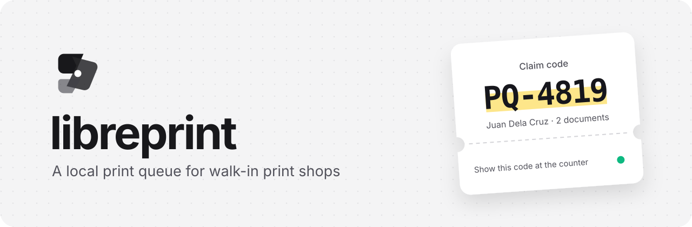

<p align="center">
  
</p>

**libreprint** replaces "send it to our Facebook page and wait" with a print queue that runs on the shop's own computer. Customers upload documents from their phones over the shop's Wi-Fi, get a paper-style claim ticket with a code like `PQ-481920`, and watch it live until it's ready. Staff see one queue, preview and print each file, and mark it done.

No customer accounts, no cloud: files and the database stay on the shop's machine.

## What it does

**For customers**
- Upload PDF, DOCX/DOC, PNG and JPG (50 MB per file, 100 MB per ticket).
- Set paper size, orientation, colour, sides, copies, page ranges and a note for each file, with a live sheet preview.
- Get a claim ticket and follow its status live: queued, printing, ready for pickup.
- Save the ticket as an image (with how-to-use steps) to show at the counter.
- Find a ticket again by its code.
- English and Filipino (more languages can be machine-translated offline), light and dark mode.

**For staff** (signed in with a shared password)
- **Overview:** what's queued, printing and recently finished, plus daily activity.
- **Print desk:** the live queue with search, filters and pagination.
- **Ticket workspace:** preview each document, open and print it, mark it done or cancel it. Updates live when someone else changes the ticket.
- **Transactions:** every ticket ever submitted, searchable, with CSV export.

## Getting started

Requires [Bun](https://bun.sh) 1.4 or newer. The database is SQLite through `bun:sqlite`, falling back to `node:sqlite` on Node.js.

```bash
bun install
bun run dev
```

The dev server listens on all network interfaces, so phones on the same Wi-Fi can open `http://<this-computer's-IP>:3000`.

| Page | URL |
|---|---|
| Customer upload | `/upload` |
| Customer ticket | `/ticket/PQ-481920` |
| Staff sign-in | `/staff/login` |
| Staff dashboard | `/staff/dashboard` |

For the shop, run a production build:

```bash
bun run build
bun run start
```

### Configuration

Set these in `.env.local` before using it in a shop.

| Variable | What it does | Default |
|---|---|---|
| `STAFF_PASSWORD` | Password for the staff sign-in. **Required in production**: staff sign-in stays off until it is set. | `admin` in development only |
| `STAFF_SESSION_SECRET` | Signs staff session cookies. Optional. | a random secret generated once into `data/.session-secret` |

Staff sign-in allows 10 attempts per 15 minutes per visitor, and looking up tickets by code allows 20 per 10 minutes. Both limits live in memory and reset when the server restarts.

### Languages

All text lives in `shared/i18n/locales/` as one JSON file per language, with English (`en.json`) as the source. Other languages are generated from it by a translation model that runs on this computer:

```bash
bun run translate          # every language in shared/i18n/languages.json
bun run translate fil      # just Filipino
```

The first run downloads Meta's NLLB model (about 600 MB) into `.cache/models/`; after that it works offline. Hand-written strings in `shared/i18n/overrides/<code>.json` always win over the machine translation, so fix a clumsy translation there and rerun. To add a language, add it to `languages.json` with its [NLLB code](https://github.com/facebookresearch/flores/blob/main/flores200/README.md#languages-in-flores-200) (e.g. Cebuano is `ceb_Latn`), run `bun run translate <code>`, then import the new file in `shared/i18n/messages.ts`.

Uploads and the database live in `data/` (`data/uploads/` and `data/printqueue.db`), which git ignores. Back up that folder to keep the shop's history.

## Project structure

The code is organised by feature: everything a feature needs lives in one folder, and features don't import each other.

```
app/                 Routing only. Pages compose features; API route files just map a URL to a handler.
features/
  auth/              Staff sign-in form and sign-in API
  staff/             Overview, print desk, ticket workspace, transactions, staff APIs
  ticket/            Customer ticket page, live status, saved ticket image, ticket APIs
  upload/            Upload form, print settings, sheet preview, upload API
    index.ts         Public API, safe for the browser
    server.ts        Public server-only API (queries, route handlers)
shared/
  components/        UI used by several features, including shadcn/ui in components/ui
  i18n/              Language list, translation files (locales/) and hand-written overrides
  lib/               i18n provider, theme, utilities
  server/            Database, file storage, live updates, staff session, ticket lookup
proxy.ts             Guards staff pages, staff APIs and uploaded files
```

Rules:
- `app/` imports a feature only through its `index.ts` or `server.ts`.
- A feature never imports another feature. When a page needs two, the route composes them.
- `shared/` never imports from `features/`.
- New shadcn components go to `shared/components/ui` (see `components.json`).

## Checks

```bash
bun run typecheck
bun run lint
bun run features/ticket/progress.check.ts
bun run shared/i18n/messages.check.ts
bun --conditions=react-server run features/staff/queries.check.ts
```

The `.check.ts` files are small self-checks that sit next to the code they test.

## Built with

Next.js 16 (App Router), React 19, Tailwind CSS 4, shadcn/ui on Radix, Zustand, Recharts, lucide icons and SQLite.

## License

Copyright 2026 fersonull.

Licensed under the [Apache License, Version 2.0](LICENSE). You may use, modify and distribute this project under its terms; it is provided "as is", without warranties.
